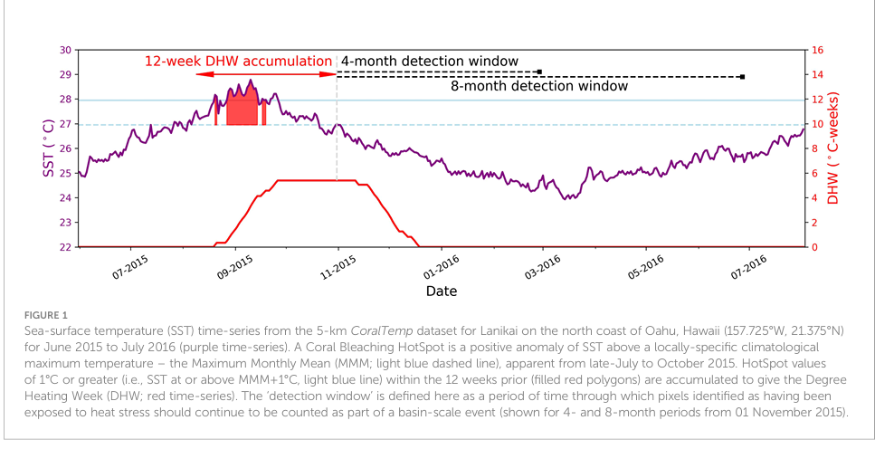

 

```{r}
#| include: false
hawaii_raw <- readLines("../data/hawaii.txt")
head(hawaii_raw, 15)
```
```{r}
#| include: false
grep("^YYYY", hawaii_raw, value = TRUE)
```
```{r}
grep("^YYYY", hawaii_raw)
```
```{r}
#| include: false
hawaii_data <- read.table(
  text = paste(hawaii_raw[-(1:22)], collapse = "\n"),
  header = FALSE
)


names(hawaii_data) <- strsplit(
  trimws(hawaii_raw[22]), "\\s+"
)[[1]]

head(hawaii_data)
```
```{r}
#| include: false
library(dplyr)

hawaii_2015 <- hawaii_data %>%
  mutate(
    date = as.Date(sprintf(
      "%04d-%02d-%02d", YYYY, MM, DD
    ))
  ) %>%
  filter(
    date >= as.Date("2015-06-01"),
    date <= as.Date("2016-07-31")
  )

nrow(hawaii_2015)
```
```{r}
#| include: false
names(hawaii_2015)
```
```{r}
#| include: false
names(hawaii_2015)[8:10]
```
```{r}
#| include: false
library(ggplot2)
library(tidyr)
```

```{r}
#| echo: false
hawaii_plot <- hawaii_2015 %>%
  select(
    date,
    SST = `SST@90th_HS`,
    DHW = `DHW_from_90th_HS>1`
  ) %>%
  pivot_longer(
    cols = c(SST, DHW),
    names_to = "variable",
    values_to = "value"
  )

```

```{r}
#| echo: false
ggplot(hawaii_plot, aes(x = date, y = value)) +
  geom_line(colour = "#0072B2", linewidth = 0.7) +
  facet_wrap(
    ~variable,
    ncol = 1,
    scales = "free_y",
    labeller = as_labeller(c(
      SST = "Sea Surface Temperature (°C)",
      DHW = "Degree Heating Weeks (°C-weeks)"
    ))
  ) +
  labs(
    title = "Sea Surface Temperature and Coral Heat Stress",
    subtitle = "Main Hawaiian Islands | June 2015–July 2016",
    x = "Date",
    y = NULL,
    caption = "Source: NOAA Coral Reef Watch | Regional virtual-station data"
  ) +
  theme_minimal(base_size = 12) +
  theme(
    strip.text = element_text(face = "bold"),
    plot.title = element_text(face = "bold"),
    panel.grid.minor = element_blank()
  )
```
## Visual Critique of the Original Scientific Figure

## Original Published Figure


**Source:** Little et al. (2022), Figure 1.

**Scientific message:** The original figure illustrates changes in sea surface temperature (SST), thermal anomalies and accumulated Degree Heating Weeks (DHW) during the 2015–2016 marine heat-stress event near Lanikai, Oahu, Hawaii.

**Limitation 1 — Dual Y-axes:** The original graph presents SST and DHW using separate vertical scales within the same plotting area. This increases the risk of misinterpreting the relationship between temperature and accumulated thermal stress.

**Limitation 2 — Visual complexity:** Multiple coloured lines, shaded regions, thresholds, arrows and detection windows compete for attention, reducing the clarity of the principal temporal patterns.

**Proposed improvement:** The reconstructed visualisation separates SST and DHW into vertically aligned panels, uses a consistent date axis, clearly identifies measurement units and applies a minimalist theme.

**Data limitation:** The reconstruction uses NOAA Coral Reef Watch's Main Hawaiian Islands regional virtual-station data rather than the original Lanikai-specific dataset. Therefore, it represents a regional comparison of the same historical period, not an exact numerical reproduction of the published figure.

